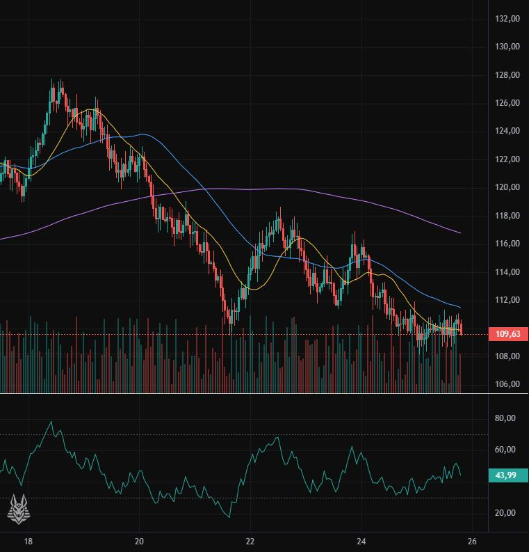
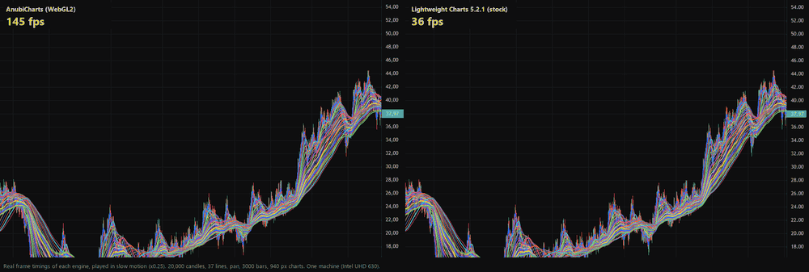
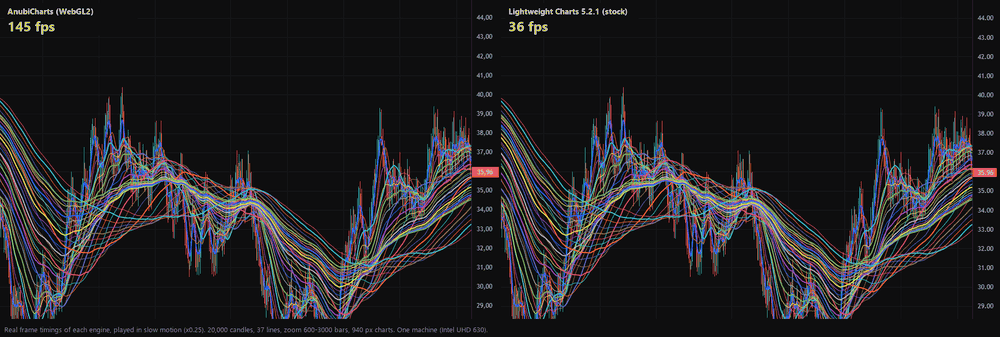

# AnubiCharts

A WebGL2 chart renderer for financial time series (candles, bars, lines, areas, histograms, multiple panes) with an API
**compatible with TradingView Lightweight Charts v5** (`createChart`, `addSeries`, `timeScale`, `priceScale`, `panes`, primitives, markers).
Made by [AnubiAI](https://anubiai.com); it is the chart engine of our trading platform, AnubiQuant. License: **Apache-2.0**.



> Status: early (0.1.0). It is not a full replacement for Lightweight Charts: see *Known limits*.

## Install

```
npm install anubicharts
```

Plain ES modules, no dependencies, no build step of its own; use it with a bundler (Vite, webpack, esbuild…) or any setup that resolves
bare imports. It needs a browser with **WebGL2** (available in current Chrome, Edge, Firefox and Safari); there is no Canvas fallback. So far it has been tested in Chrome only.

## Quick start

```html
<div id="chart" style="width:800px;height:400px"></div>
<script type="module">
  import { createChart, CandlestickSeries } from 'anubicharts';
  const chart = createChart(document.getElementById('chart'), { autoSize: true });
  const series = chart.addSeries(CandlestickSeries, {});
  series.setData([{ time: 1700000000, open: 1, high: 2, low: 0.5, close: 1.5 } /* ... */]);
</script>
```

Without a bundler, import it straight from a CDN instead (a bare `'anubicharts'` import only works where a bundler or import map resolves it):

```js
import { createChart, CandlestickSeries } from 'https://cdn.jsdelivr.net/npm/anubicharts@0.1.0/src/lw.js';
```

To try it from a clone instead, import `./src/lw.js` as the examples do, and serve the folder with any static server (ES modules do not
load from `file://`), for example `python -m http.server`:

- `examples/basic.html`: 20,000 candles with volume.
- `examples/benchmark.html`: pan and zoom tests for each engine (see *Performance*).
- `examples/solo.html`: one engine per page with a live frame counter (`?engine=aq|lw`, `?mode=zoom`, `?vis=3000`, `?w=940`).
- `examples/compare.html`: the two engines side by side, panned in the same animation frame.

The Anubi mark is shown at the bottom-left of the first pane, like the logo of Lightweight Charts; turn it off with `layout: { attributionLogo: false }`.

## Coming from Lightweight Charts

Change the import and keep the rest:

```js
// before
import { createChart, CandlestickSeries } from 'lightweight-charts';
// after
import { createChart, CandlestickSeries } from 'anubicharts';
```

Provided: `createChart`; the series `CandlestickSeries`, `BarSeries`, `LineSeries`, `AreaSeries`, `BaselineSeries`, `HistogramSeries`;
`createSeriesMarkers`; `timeScale()`, `priceScale()`, `panes()`, primitives, price lines, crosshair and `takeScreenshot`; the enums
`LineStyle`, `LineType`, `CrosshairMode`, `PriceScaleMode`, `ColorType`, `LastPriceAnimationMode`, `PriceLineSource`, `TickMarkType`,
`MismatchDirection`, `TrackingModeExitMode`; and `isBusinessDay` / `isUTCTimestamp`. Not provided: custom series and the other chart types
(`createChartEx`, yield curve, options charts) and the watermark plugins. A few visual details differ, see *Known limits*.

## How it works

Series data is stored in columns with a level-of-detail pyramid (min/max of any range in O(log n)). Candles and lines are uploaded to
the GPU once, and panning and zooming are done with uniforms, so scrolling does not rewrite buffers. One WebGL canvas serves all panes.

## Performance

Measured against the **stock** Lightweight Charts 5.2.1, one engine per page (`examples/solo.html`), 20,000 candles + 37 moving averages,
Chrome on Windows, the integrated Intel UHD 630 (the GPU the browser used on this machine):

| Display / chart width / visible bars | AnubiCharts | Lightweight Charts 5.2.1 |
|---|---|---|
| 144 Hz, 940 px, 3000 bars: pan | 6.9 ms/frame (145 fps) | 27.8 ms/frame (36 fps) |
| 144 Hz, 940 px, 3000 bars: zoom 600-3000 | 6.9 ms/frame (145 fps) | 27.7 ms/frame (36 fps) |
| 144 Hz, 470 px, 3000 bars: pan or zoom | 6.9 ms/frame (145 fps) | 13.9 ms/frame (72 fps) |
| 144 Hz, full-width page, 600 bars: pan (`benchmark.html`) | 6.9 ms/frame | 13.9 ms/frame (p95 20.8 ms) |
| **60 Hz**, 761 px, 3000 bars: pan | 16.7 ms/frame (60 fps, no frame over 20 ms) | 33.4 ms/frame (30 fps, p95 50.2 ms) |

Numbers are medians of the interval between animation frames, i.e. what the browser produces. AnubiCharts sits at the refresh period of the
display, so it cannot show less than that. The advantage depends on how much there is to draw (width, visible bars, number of series).
This is **one machine and one scenario**. On a phone with a 144 Hz display AnubiCharts ran at 144 fps (informal check, not measured with
the benchmark page).

The videos replay the 144 Hz timings of each engine in slow motion (x0.25); they are rebuilt from the measured frame timings, not screen
recordings (MP4 versions: `docs/compare-fps.mp4`, `docs/compare-zoom.mp4`).





**Measure it yourself.** Open `examples/benchmark.html` over HTTP and run the pan and zoom tests for each engine. The page loads
**unmodified** Lightweight Charts 5.2.1 from a CDN, uses the same deterministic data for both, and reports the median, 95th percentile and
maximum frame interval plus your GPU and browser. Run each engine several times and ignore the first run. With monitors of different
refresh rates, set the one you test on as the primary display: on a 60 Hz monitor next to a 144 Hz one, Chrome on Windows kept reporting
about 143 frames per second while the screen showed 60. We would love numbers from other GPUs and from real phones (open an issue).

## Tests

`npm test` runs 28 tests (Node 18+, no dependencies) on the pure parts: candle, bar and histogram geometry against measurements of
Lightweight Charts' rendered output (`test/fixtures/`), price and time scales, tick selection, the data pyramid and the dash phase.
WebGL rendering itself is not covered by automated tests yet.

## Known limits

- Tested in Chrome (on Windows) only; Firefox and Safari are untested.
- Phone testing is informal so far (one phone with a 144 Hz display, no benchmark numbers); a crash seen on one phone earlier has not been reproduced in emulation.
- Fractional device pixel ratios were checked only with an emulated test bench.
- Axis time labels differ from Lightweight Charts in some timeframes.
- The last-value label on the price scale (last visible bar, as in Lightweight Charts) was matched in 39 measured cases, not exhaustively.
- No custom series; Pine-style plots are not native series.
- Below 1 px per bar the engine aggregates bars (by design).

## Relation to Lightweight Charts

The public API follows Lightweight Charts v5 for compatibility. Several geometry details (candle and bar widths, histogram columns, ticks)
were reproduced by measuring Lightweight Charts' pixel output; some parts are still treated as derived works and are declared in
`DERIVAZIONE.md` and `NOTICE`, with attribution to TradingView, Inc. (Apache-2.0). This is **not** a clean-room implementation.
Lightweight Charts is a trademark of TradingView, Inc.; this project is not affiliated with or endorsed by TradingView.

## License

Apache-2.0, see `LICENSE` and `NOTICE`. Copyright (c) 2026 AnubiAI (anubiai.com).
